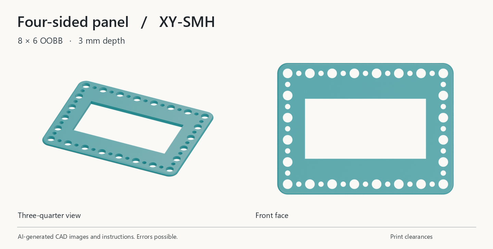
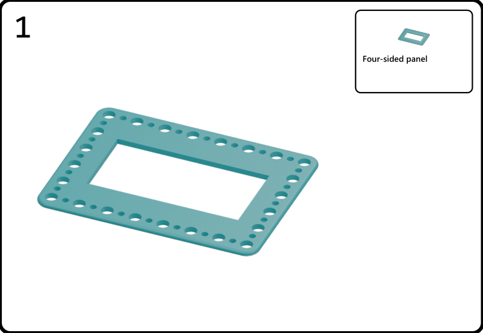
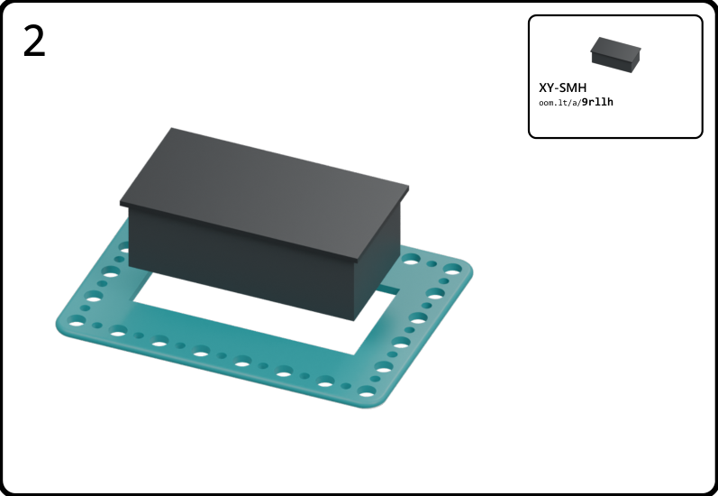
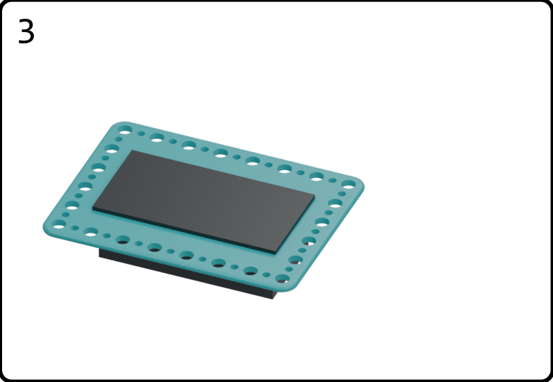

<!-- oobb-presentation:start -->
# OOBB panel-mount electronics holders

AI-generated CAD images and instructions. Errors possible.

## Summary

Snap a rectangular panel-mount device into an OOBB panel or an open-backed box with a removable cable plate. A matching solid cutter brings the same clip shoulder into another CAD design.

Device dimensions come from the [OOMP panel-mount catalog](https://github.com/oomlout/oomp_electronic_panel_mount_version_5) maintained by [Oom Lout](https://github.com/oomlout).

This is an entirely AI-generated coding project. The source code is largely unreadable by humans. The generated files are included so others can use and modify the designs with their own AI tools.

[XY-SMH four-sided panel](parts/oobb_part_holder_electronic_panel_mount_motor_controller_stepper_single_axis_aliexpress_xy_smh_panel_8_width_6_height_3_depth/)

## Details

[Browse the 4 entries by taxonomy](navigation_oobb/oobb/part/holder/electronic_panel_mount_motor_controller_stepper_single_axis_aliexpress_xy_smh/). After the style, width and height count 15 mm OOBB grid units. Depth is in millimetres. The cutter uses the smallest OOBB envelope that contains its pocket.

Run `python make_all.py` to rebuild the catalog, CAD, illustrations and instructions. [Build guide](BUILD.md)

## Parts

Choose a panel for an existing enclosure or an open-backed box with a removable cable plate. The width-only styles leave the top and bottom edges free of front mounting rows. Choose the positive cutter to design your own enclosure.

| Device and design | OOBB grid | Depth | STL |
| --- | --- | --- | --- |
| [XY-SMH · Side-mount box](parts/oobb_part_holder_electronic_panel_mount_motor_controller_stepper_single_axis_aliexpress_xy_smh_box_width_only_8_width_4_height_41_depth/) | 8 × 4 | 41 mm | [Print layout](parts/oobb_part_holder_electronic_panel_mount_motor_controller_stepper_single_axis_aliexpress_xy_smh_box_width_only_8_width_4_height_41_depth/3dpr.stl) |
| [XY-SMH · Clip-in cutter](parts/oobb_part_holder_electronic_panel_mount_motor_controller_stepper_single_axis_aliexpress_xy_smh_cutout_only_6_width_4_height_29_depth/) | 6 × 4 | 29 mm | [CAD cutter](parts/oobb_part_holder_electronic_panel_mount_motor_controller_stepper_single_axis_aliexpress_xy_smh_cutout_only_6_width_4_height_29_depth/true.stl) |
| [XY-SMH · Four-sided panel](parts/oobb_part_holder_electronic_panel_mount_motor_controller_stepper_single_axis_aliexpress_xy_smh_panel_8_width_6_height_3_depth/) | 8 × 6 | 3 mm | [Print](parts/oobb_part_holder_electronic_panel_mount_motor_controller_stepper_single_axis_aliexpress_xy_smh_panel_8_width_6_height_3_depth/3dpr.stl) |
| [XY-SMH · Side-mount panel](parts/oobb_part_holder_electronic_panel_mount_motor_controller_stepper_single_axis_aliexpress_xy_smh_panel_width_only_8_width_4_height_3_depth/) | 8 × 4 | 3 mm | [Print](parts/oobb_part_holder_electronic_panel_mount_motor_controller_stepper_single_axis_aliexpress_xy_smh_panel_width_only_8_width_4_height_3_depth/3dpr.stl) |

## Assembly

The [XY-SMH four-sided panel](parts/oobb_part_holder_electronic_panel_mount_motor_controller_stepper_single_axis_aliexpress_xy_smh_panel_8_width_6_height_3_depth/#assembly) illustrates the clip-in sequence. Each holder page includes its own views and printable booklet.

1. Print one holder using the 3D-print STL. Clear the opening and identify the front face.

   

2. With the device disconnected, align its body with the opening. Keep the bezel outside the holder.

   

3. Press the body straight into the opening until the bezel sits flat. Check that the clips engage before mounting the holder.

   

The gray shape represents the catalog device envelope. Clip travel and physical fit still need a sample print.

[Offline HTML viewer](parts/oobb_part_holder_electronic_panel_mount_motor_controller_stepper_single_axis_aliexpress_xy_smh_panel_8_width_6_height_3_depth/assembly/assembly_instructions.html) · [Printable PDF](parts/oobb_part_holder_electronic_panel_mount_motor_controller_stepper_single_axis_aliexpress_xy_smh_panel_8_width_6_height_3_depth/assembly/assembly_instructions.pdf)
<!-- oobb-presentation:end -->
