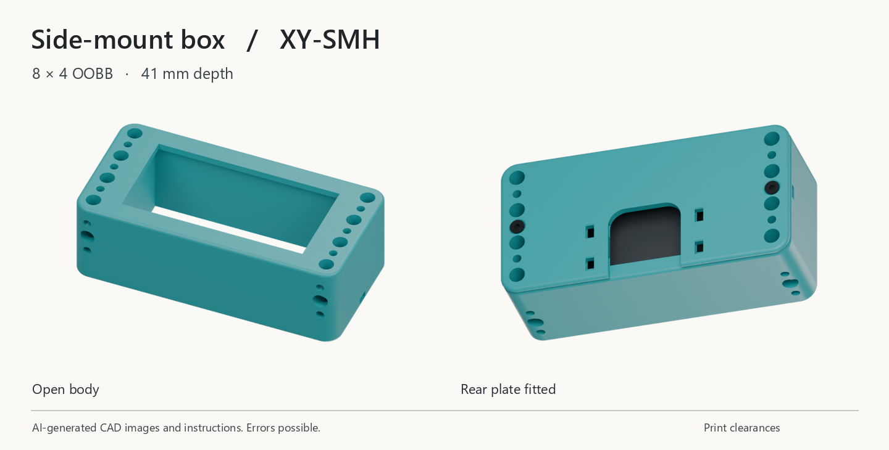
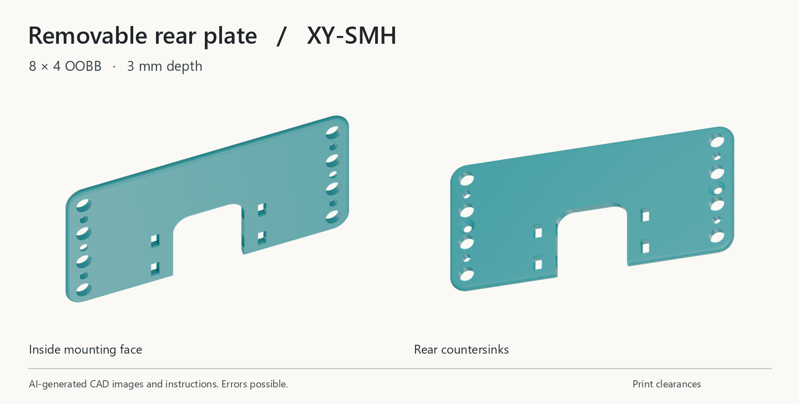
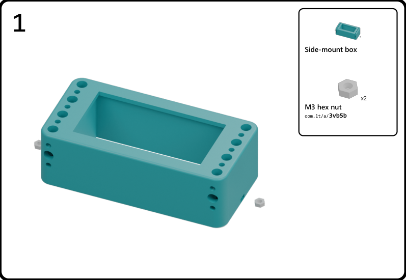
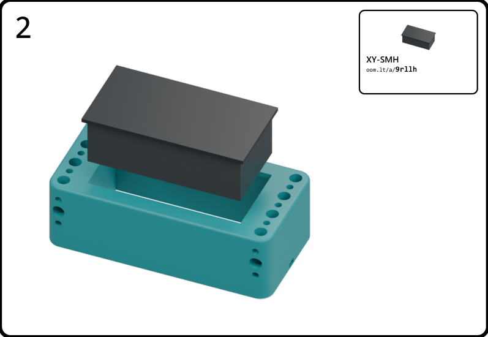
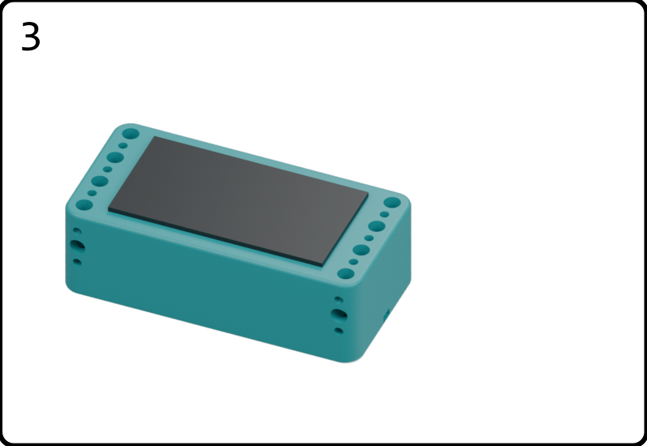
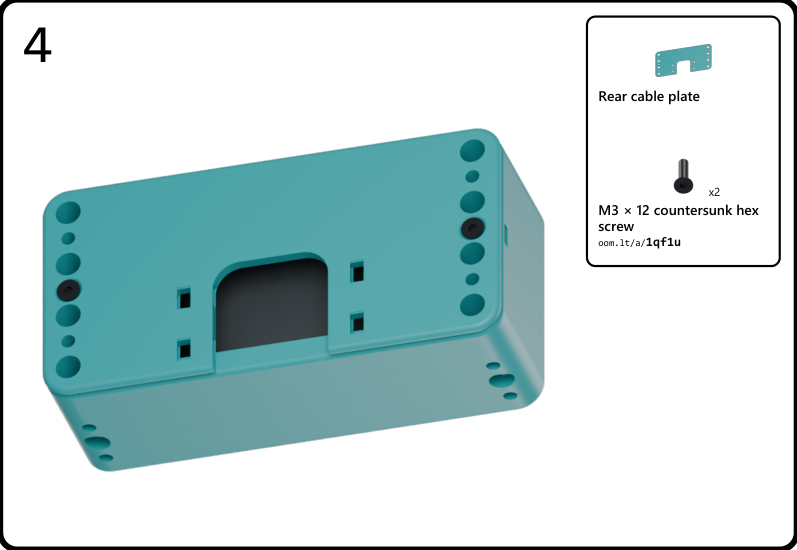

<!-- oobb-presentation:start -->
# XY-SMH · Side-mount box

AI-generated CAD images and instructions. Errors possible.

## Summary

An open-backed box with a removable U-shaped rear plate and side-loaded M3 nuts.

This is an entirely AI-generated coding project. The source code is largely unreadable by humans. The generated files are included so others can use and modify the designs with their own AI tools.

[](../../../../../../../../../parts/oobb_part_holder_electronic_panel_mount_motor_controller_stepper_single_axis_aliexpress_xy_smh_box_width_only_8_width_4_height_41_depth/)

## Details

**Full OOMP ID** `oobb_part_holder_electronic_panel_mount_motor_controller_stepper_single_axis_aliexpress_xy_smh_box_width_only_8_width_4_height_41_depth`

[Part folder](../../../../../../../../../parts/oobb_part_holder_electronic_panel_mount_motor_controller_stepper_single_axis_aliexpress_xy_smh_box_width_only_8_width_4_height_41_depth/) · [OOBB navigation](./) · [Source device](https://github.com/oomlout/oomp_electronic_panel_mount_version_5/tree/main/parts/electronic_panel_mount_motor_controller_stepper_single_axis_86_mm_width_45_mm_height_28_mm_depth_aliexpress_xy_smh)

| Dimension | Value |
| --- | --- |
| OOBB width × height | 8 × 4 grid units |
| Depth | 41 mm |
| Front opening | 81.6 × 40.6 mm |
| Clip shoulder | 3 mm |

The assembled depth includes a 38 mm open body and a 3 mm rear plate. The [print layout](../../../../../../../../../parts/oobb_part_holder_electronic_panel_mount_motor_controller_stepper_single_axis_aliexpress_xy_smh_box_width_only_8_width_4_height_41_depth/3dpr.stl) places both pieces side by side. Separate files are available for [the body](../../../../../../../../../parts/oobb_part_holder_electronic_panel_mount_motor_controller_stepper_single_axis_aliexpress_xy_smh_box_width_only_8_width_4_height_41_depth/body_3dpr.stl) and [the plate](../../../../../../../../../parts/oobb_part_holder_electronic_panel_mount_motor_controller_stepper_single_axis_aliexpress_xy_smh_box_width_only_8_width_4_height_41_depth/back_plate_3dpr.stl).



The bottom-center cable opening spans two OOBB pitches. Four M3 holes around it accept side-loaded patch-panel nuts. The mounting bores pass through the body and rear plate. The two rear screws occupy one M3 bore on each side when fitted.

<details>
<summary>Complete OOMP metadata</summary>

```yaml
assembly_steps:
- action: Print the two pieces laid out in the box STL. Slide one M3 nut into the
    middle side slot on each body rail. Leave those slots empty when you need both
    M3 bores clear.
  view: part_holder
- action: With the device disconnected, align its body with the opening. Keep the
    bezel outside the holder.
  view: aligned
- action: Press the body straight into the opening until the bezel sits flat. Check
    that the clips engage before mounting the holder.
  view: seated
- action: Lay the wires in the bottom opening. Face the countersinks out and fit one
    M3 × 12 mm screw per side from the rear. For a patch panel, slide four M3 nuts
    from the wire opening into the plate.
  view: joined
bip_39_2_word_array:
- grace
- economy
bip_39_2_word_no_space: graceeconomy
bip_39_2_word_space: grace economy
bip_39_2_word_underscore: grace_economy
bip_39_3_word_array:
- grace
- economy
- blur
bip_39_3_word_no_space: graceeconomyblur
bip_39_3_word_space: grace economy blur
bip_39_3_word_underscore: grace_economy_blur
bip_39_full_array:
- grace
- economy
- blur
- order
- tennis
- food
- erupt
- shove
- cradle
- pistol
- satoshi
- assist
bip_39_full_no_space: graceeconomyblurordertennisfooderuptshovecradlepistolsatoshiassist
bip_39_full_space: grace economy blur order tennis food erupt shove cradle pistol
  satoshi assist
bip_39_full_underscore: grace_economy_blur_order_tennis_food_erupt_shove_cradle_pistol_satoshi_assist
device_label: xy_smh
directory: parts/oobb_part_holder_electronic_panel_mount_motor_controller_stepper_single_axis_aliexpress_xy_smh_box_width_only_8_width_4_height_41_depth
id: oobb_part_holder_electronic_panel_mount_motor_controller_stepper_single_axis_aliexpress_xy_smh_box_width_only_8_width_4_height_41_depth
id_no_class: oobb_part_holder_electronic_panel_mount_motor_controller_stepper_single_axis_aliexpress_xy_smh_box_width_only_8_width_4_height_41_depth
id_no_size: oobb_part_holder_electronic_panel_mount_motor_controller_stepper_single_axis_aliexpress_xy_smh_box_width_only_8_width_4_height_41_depth
id_no_type: oobb_part_holder_electronic_panel_mount_motor_controller_stepper_single_axis_aliexpress_xy_smh_box_width_only_8_width_4_height_41_depth
md5: 6568c461ce1df2b5933e3831f4aefd86
md5_10: 6568c461ce
md5_10_upper: 6568C461CE
md5_5: 6568c
md5_5_upper: 6568C
md5_6: 6568c4
md5_6_alpha: 3yg1w
md5_6_alpha_upper: 3YG1W
md5_6_upper: 6568C4
name: Oobb Part Holder Electronic Panel Mount Motor Controller Stepper Single Axis
  Aliexpress Xy Smh Box Width Only 8 Width 4 Height 41 Depth
name_no_class: Oobb Part Holder Electronic Panel Mount Motor Controller Stepper Single
  Axis Aliexpress Xy Smh Box Width Only 8 Width 4 Height 41 Depth
name_no_size: Oobb Part Holder Electronic Panel Mount Motor Controller Stepper Single
  Axis Aliexpress Xy Smh Box Width Only 8 Width 4 Height 41 Depth
name_no_type: Oobb Part Holder Electronic Panel Mount Motor Controller Stepper Single
  Axis Aliexpress Xy Smh Box Width Only 8 Width 4 Height 41 Depth
oobb_details:
  back_plate_depth_mm: 3
  body_depth_mm: 38
  cavity_depth_mm: 29
  cavity_height_mm: 46.0
  cavity_width_mm: 87.0
  corner_radius_mm: 7
  depth: 41
  depth_cutout_mm: 3
  depth_mm: 28
  edge_radius_mm: 1.5
  embedded_nut_depth_mm: 3
  future_mount_rows_mm:
  - -22.5
  - -7.5
  future_mount_x_mm: 22.5
  height: 4
  height_cutout_mm: 40.6
  height_mm: 45
  join_nut_skin_mm: 1.5
  join_screw_length_mm: 12
  join_x_mm: 52.5
  join_y_mm: 0
  oobb_type: box_width_only
  patch_nut_depth_mm: 2.5
  run_scad: true
  variant: box_width_only
  width: 8
  width_cutout_mm: 81.6
  width_mm: 86
  wire_bottom_y_mm: -29.5
  wire_height_mm: 30
  wire_width_mm: 30
oomp_key: oomp_oobb_part_holder_electronic_panel_mount_motor_controller_stepper_single_axis_aliexpress_xy_smh_box_width_only_8_width_4_height_41_depth
source_device_url: https://github.com/oomlout/oomp_electronic_panel_mount_version_5/tree/main/parts/electronic_panel_mount_motor_controller_stepper_single_axis_86_mm_width_45_mm_height_28_mm_depth_aliexpress_xy_smh
source_oomp_id: electronic_panel_mount_motor_controller_stepper_single_axis_86_mm_width_45_mm_height_28_mm_depth_aliexpress_xy_smh
taxonomy_1: oobb
taxonomy_10: ''
taxonomy_11: ''
taxonomy_12: ''
taxonomy_13: ''
taxonomy_14: ''
taxonomy_15: ''
taxonomy_1_capital: Oobb
taxonomy_1_first_letter: o
taxonomy_1_first_letter_upper: O
taxonomy_1_length_1: o
taxonomy_1_length_2: oo
taxonomy_1_length_3: oob
taxonomy_1_length_4: oobb
taxonomy_1_length_5: oobb
taxonomy_1_upper: OOBB
taxonomy_1_upper_length_1: O
taxonomy_1_upper_length_2: OO
taxonomy_1_upper_length_3: OOB
taxonomy_1_upper_length_4: OOBB
taxonomy_1_upper_length_5: OOBB
taxonomy_2: part
taxonomy_2_capital: Part
taxonomy_2_first_letter: p
taxonomy_2_first_letter_upper: P
taxonomy_2_length_1: p
taxonomy_2_length_2: pa
taxonomy_2_length_3: par
taxonomy_2_length_4: part
taxonomy_2_length_5: part
taxonomy_2_upper: PART
taxonomy_2_upper_length_1: P
taxonomy_2_upper_length_2: PA
taxonomy_2_upper_length_3: PAR
taxonomy_2_upper_length_4: PART
taxonomy_2_upper_length_5: PART
taxonomy_3: holder
taxonomy_3_capital: Holder
taxonomy_3_first_letter: h
taxonomy_3_first_letter_upper: H
taxonomy_3_length_1: h
taxonomy_3_length_2: ho
taxonomy_3_length_3: hol
taxonomy_3_length_4: hold
taxonomy_3_length_5: holde
taxonomy_3_upper: HOLDER
taxonomy_3_upper_length_1: H
taxonomy_3_upper_length_2: HO
taxonomy_3_upper_length_3: HOL
taxonomy_3_upper_length_4: HOLD
taxonomy_3_upper_length_5: HOLDE
taxonomy_4: electronic_panel_mount_motor_controller_stepper_single_axis_aliexpress_xy_smh
taxonomy_4_capital: Electronic Panel Mount Motor Controller Stepper Single Axis Aliexpress
  Xy Smh
taxonomy_4_first_letter: e
taxonomy_4_first_letter_upper: E
taxonomy_4_length_1: e
taxonomy_4_length_2: el
taxonomy_4_length_3: ele
taxonomy_4_length_4: elec
taxonomy_4_length_5: elect
taxonomy_4_upper: ELECTRONIC_PANEL_MOUNT_MOTOR_CONTROLLER_STEPPER_SINGLE_AXIS_ALIEXPRESS_XY_SMH
taxonomy_4_upper_length_1: E
taxonomy_4_upper_length_2: EL
taxonomy_4_upper_length_3: ELE
taxonomy_4_upper_length_4: ELEC
taxonomy_4_upper_length_5: ELECT
taxonomy_5: box_width_only
taxonomy_5_capital: Box Width Only
taxonomy_5_first_letter: b
taxonomy_5_first_letter_upper: B
taxonomy_5_length_1: b
taxonomy_5_length_2: bo
taxonomy_5_length_3: box
taxonomy_5_length_4: box_
taxonomy_5_length_5: box_w
taxonomy_5_upper: BOX_WIDTH_ONLY
taxonomy_5_upper_length_1: B
taxonomy_5_upper_length_2: BO
taxonomy_5_upper_length_3: BOX
taxonomy_5_upper_length_4: BOX_
taxonomy_5_upper_length_5: BOX_W
taxonomy_6: 8_width
taxonomy_6_capital: 8 Width
taxonomy_6_first_letter: '8'
taxonomy_6_first_letter_upper: '8'
taxonomy_6_length_1: '8'
taxonomy_6_length_2: '8_'
taxonomy_6_length_3: 8_w
taxonomy_6_length_4: 8_wi
taxonomy_6_length_5: 8_wid
taxonomy_6_upper: 8_WIDTH
taxonomy_6_upper_length_1: '8'
taxonomy_6_upper_length_2: '8_'
taxonomy_6_upper_length_3: 8_W
taxonomy_6_upper_length_4: 8_WI
taxonomy_6_upper_length_5: 8_WID
taxonomy_7: 4_height
taxonomy_7_capital: 4 Height
taxonomy_7_first_letter: '4'
taxonomy_7_first_letter_upper: '4'
taxonomy_7_length_1: '4'
taxonomy_7_length_2: '4_'
taxonomy_7_length_3: 4_h
taxonomy_7_length_4: 4_he
taxonomy_7_length_5: 4_hei
taxonomy_7_upper: 4_HEIGHT
taxonomy_7_upper_length_1: '4'
taxonomy_7_upper_length_2: '4_'
taxonomy_7_upper_length_3: 4_H
taxonomy_7_upper_length_4: 4_HE
taxonomy_7_upper_length_5: 4_HEI
taxonomy_8: 41_depth
taxonomy_8_capital: 41 Depth
taxonomy_8_first_letter: '4'
taxonomy_8_first_letter_upper: '4'
taxonomy_8_length_1: '4'
taxonomy_8_length_2: '41'
taxonomy_8_length_3: '41_'
taxonomy_8_length_4: 41_d
taxonomy_8_length_5: 41_de
taxonomy_8_upper: 41_DEPTH
taxonomy_8_upper_length_1: '4'
taxonomy_8_upper_length_2: '41'
taxonomy_8_upper_length_3: '41_'
taxonomy_8_upper_length_4: 41_D
taxonomy_8_upper_length_5: 41_DE
taxonomy_9: ''
```

</details>

## Parts

One printed body, one rear plate, one [XY-SMH](https://github.com/oomlout/oomp_electronic_panel_mount_version_5/tree/main/parts/electronic_panel_mount_motor_controller_stepper_single_axis_86_mm_width_45_mm_height_28_mm_depth_aliexpress_xy_smh), two M3 × 12 mm countersunk screws and two M3 hex nuts. Add four more M3 nuts when fitting a patch panel.

## Assembly

1. Print the two pieces laid out in the box STL. Slide one M3 nut into the middle side slot on each body rail. Leave those slots empty when you need both M3 bores clear.

   <a href="../../../../../../../../../parts/oobb_part_holder_electronic_panel_mount_motor_controller_stepper_single_axis_aliexpress_xy_smh_box_width_only_8_width_4_height_41_depth/assembly/cards/step_01.png"></a>

2. With the device disconnected, align its body with the opening. Keep the bezel outside the holder.

   <a href="../../../../../../../../../parts/oobb_part_holder_electronic_panel_mount_motor_controller_stepper_single_axis_aliexpress_xy_smh_box_width_only_8_width_4_height_41_depth/assembly/cards/step_02.png"></a>

3. Press the body straight into the opening until the bezel sits flat. Check that the clips engage before mounting the holder.

   <a href="../../../../../../../../../parts/oobb_part_holder_electronic_panel_mount_motor_controller_stepper_single_axis_aliexpress_xy_smh_box_width_only_8_width_4_height_41_depth/assembly/cards/step_03.png"></a>

4. Lay the wires in the bottom opening. Face the countersinks out and fit one M3 × 12 mm screw per side from the rear. For a patch panel, slide four M3 nuts from the wire opening into the plate.

   <a href="../../../../../../../../../parts/oobb_part_holder_electronic_panel_mount_motor_controller_stepper_single_axis_aliexpress_xy_smh_box_width_only_8_width_4_height_41_depth/assembly/cards/step_04.png"></a>

The gray shape represents the catalog device envelope. Clip travel and physical fit still need a sample print.

[Offline HTML viewer](../../../../../../../../../parts/oobb_part_holder_electronic_panel_mount_motor_controller_stepper_single_axis_aliexpress_xy_smh_box_width_only_8_width_4_height_41_depth/assembly/assembly_instructions.html) · [Printable PDF](../../../../../../../../../parts/oobb_part_holder_electronic_panel_mount_motor_controller_stepper_single_axis_aliexpress_xy_smh_box_width_only_8_width_4_height_41_depth/assembly/assembly_instructions.pdf)
<!-- oobb-presentation:end -->
