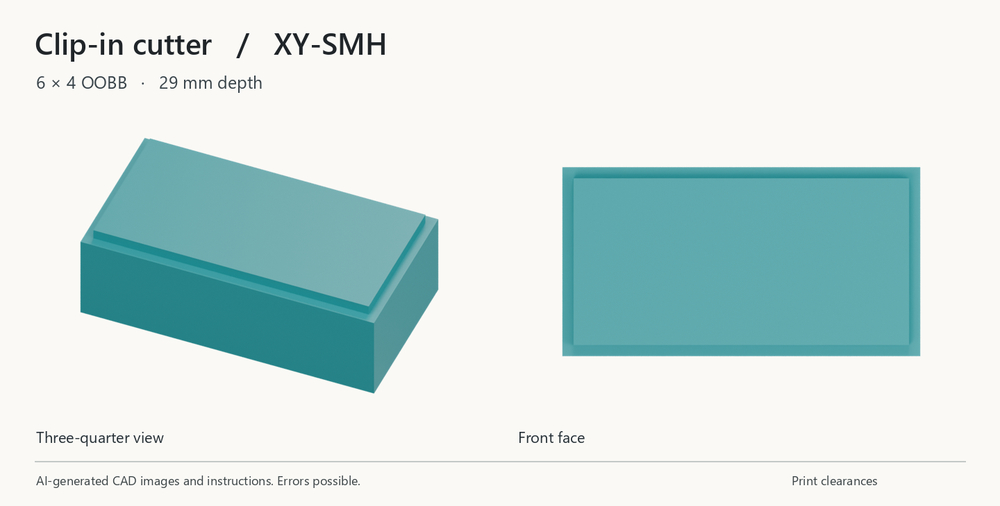

<!-- oobb-presentation:start -->
# XY-SMH · Clip-in cutter

AI-generated CAD images and instructions. Errors possible.

## Summary

A positive CAD tool for cutting a clip-in pocket into a solid block.

This is an entirely AI-generated coding project. The source code is largely unreadable by humans. The generated files are included so others can use and modify the designs with their own AI tools.

[](../../../../../../../../../parts/oobb_part_holder_electronic_panel_mount_motor_controller_stepper_single_axis_aliexpress_xy_smh_cutout_only_6_width_4_height_29_depth/)

## Details

**Full OOMP ID** `oobb_part_holder_electronic_panel_mount_motor_controller_stepper_single_axis_aliexpress_xy_smh_cutout_only_6_width_4_height_29_depth`

[Part folder](../../../../../../../../../parts/oobb_part_holder_electronic_panel_mount_motor_controller_stepper_single_axis_aliexpress_xy_smh_cutout_only_6_width_4_height_29_depth/) · [OOBB navigation](./) · [Source device](https://github.com/oomlout/oomp_electronic_panel_mount_version_5/tree/main/parts/electronic_panel_mount_motor_controller_stepper_single_axis_86_mm_width_45_mm_height_28_mm_depth_aliexpress_xy_smh)

| Dimension | Value |
| --- | --- |
| OOBB width × height | 6 × 4 grid units |
| Depth | 29 mm |
| Front opening | 81.6 × 40.6 mm |
| Clip shoulder | 3 mm |

The grid dimensions describe its bounding envelope. The cutter measures 87 × 46 × 29 mm.

<details>
<summary>Complete OOMP metadata</summary>

```yaml
assembly_steps:
- action: Import the positive cutter alongside the block you want to machine or print.
  view: angle
- action: Align its narrow end with the outside face of the block. The wider pocket
    extends inward along positive Z.
  view: top
- action: Subtract the cutter from the block. Inspect the opening and the retaining
    shoulder in section before exporting.
  view: angle
bip_39_2_word_array:
- garlic
- voice
bip_39_2_word_no_space: garlicvoice
bip_39_2_word_space: garlic voice
bip_39_2_word_underscore: garlic_voice
bip_39_3_word_array:
- garlic
- voice
- forward
bip_39_3_word_no_space: garlicvoiceforward
bip_39_3_word_space: garlic voice forward
bip_39_3_word_underscore: garlic_voice_forward
bip_39_full_array:
- garlic
- voice
- forward
- coil
- estate
- fringe
- thrive
- section
- dog
- rebuild
- observe
- deputy
bip_39_full_no_space: garlicvoiceforwardcoilestatefringethrivesectiondogrebuildobservedeputy
bip_39_full_space: garlic voice forward coil estate fringe thrive section dog rebuild
  observe deputy
bip_39_full_underscore: garlic_voice_forward_coil_estate_fringe_thrive_section_dog_rebuild_observe_deputy
device_label: xy_smh
directory: parts/oobb_part_holder_electronic_panel_mount_motor_controller_stepper_single_axis_aliexpress_xy_smh_cutout_only_6_width_4_height_29_depth
id: oobb_part_holder_electronic_panel_mount_motor_controller_stepper_single_axis_aliexpress_xy_smh_cutout_only_6_width_4_height_29_depth
id_no_class: oobb_part_holder_electronic_panel_mount_motor_controller_stepper_single_axis_aliexpress_xy_smh_cutout_only_6_width_4_height_29_depth
id_no_size: oobb_part_holder_electronic_panel_mount_motor_controller_stepper_single_axis_aliexpress_xy_smh_cutout_only_6_width_4_height_29_depth
id_no_type: oobb_part_holder_electronic_panel_mount_motor_controller_stepper_single_axis_aliexpress_xy_smh_cutout_only_6_width_4_height_29_depth
md5: 5fdead6f16a4d6ba384e1540966a619d
md5_10: 5fdead6f16
md5_10_upper: 5FDEAD6F16
md5_5: 5fdea
md5_5_upper: 5FDEA
md5_6: 5fdead
md5_6_alpha: 3qnxp
md5_6_alpha_upper: 3QNXP
md5_6_upper: 5FDEAD
name: Oobb Part Holder Electronic Panel Mount Motor Controller Stepper Single Axis
  Aliexpress Xy Smh Cutout Only 6 Width 4 Height 29 Depth
name_no_class: Oobb Part Holder Electronic Panel Mount Motor Controller Stepper Single
  Axis Aliexpress Xy Smh Cutout Only 6 Width 4 Height 29 Depth
name_no_size: Oobb Part Holder Electronic Panel Mount Motor Controller Stepper Single
  Axis Aliexpress Xy Smh Cutout Only 6 Width 4 Height 29 Depth
name_no_type: Oobb Part Holder Electronic Panel Mount Motor Controller Stepper Single
  Axis Aliexpress Xy Smh Cutout Only 6 Width 4 Height 29 Depth
oobb_details:
  cavity_depth_mm: 29
  cavity_height_mm: 46.0
  cavity_width_mm: 87.0
  corner_radius_mm: 7
  depth: 29
  depth_cutout_mm: 3
  depth_mm: 28
  edge_radius_mm: 1.5
  height: 4
  height_cutout_mm: 40.6
  height_mm: 45
  oobb_type: cutout_only
  run_scad: true
  variant: cutout_only
  width: 6
  width_cutout_mm: 81.6
  width_mm: 86
oomp_key: oomp_oobb_part_holder_electronic_panel_mount_motor_controller_stepper_single_axis_aliexpress_xy_smh_cutout_only_6_width_4_height_29_depth
source_device_url: https://github.com/oomlout/oomp_electronic_panel_mount_version_5/tree/main/parts/electronic_panel_mount_motor_controller_stepper_single_axis_86_mm_width_45_mm_height_28_mm_depth_aliexpress_xy_smh
source_oomp_id: electronic_panel_mount_motor_controller_stepper_single_axis_86_mm_width_45_mm_height_28_mm_depth_aliexpress_xy_smh
taxonomy_1: oobb
taxonomy_10: ''
taxonomy_11: ''
taxonomy_12: ''
taxonomy_13: ''
taxonomy_14: ''
taxonomy_15: ''
taxonomy_1_capital: Oobb
taxonomy_1_first_letter: o
taxonomy_1_first_letter_upper: O
taxonomy_1_length_1: o
taxonomy_1_length_2: oo
taxonomy_1_length_3: oob
taxonomy_1_length_4: oobb
taxonomy_1_length_5: oobb
taxonomy_1_upper: OOBB
taxonomy_1_upper_length_1: O
taxonomy_1_upper_length_2: OO
taxonomy_1_upper_length_3: OOB
taxonomy_1_upper_length_4: OOBB
taxonomy_1_upper_length_5: OOBB
taxonomy_2: part
taxonomy_2_capital: Part
taxonomy_2_first_letter: p
taxonomy_2_first_letter_upper: P
taxonomy_2_length_1: p
taxonomy_2_length_2: pa
taxonomy_2_length_3: par
taxonomy_2_length_4: part
taxonomy_2_length_5: part
taxonomy_2_upper: PART
taxonomy_2_upper_length_1: P
taxonomy_2_upper_length_2: PA
taxonomy_2_upper_length_3: PAR
taxonomy_2_upper_length_4: PART
taxonomy_2_upper_length_5: PART
taxonomy_3: holder
taxonomy_3_capital: Holder
taxonomy_3_first_letter: h
taxonomy_3_first_letter_upper: H
taxonomy_3_length_1: h
taxonomy_3_length_2: ho
taxonomy_3_length_3: hol
taxonomy_3_length_4: hold
taxonomy_3_length_5: holde
taxonomy_3_upper: HOLDER
taxonomy_3_upper_length_1: H
taxonomy_3_upper_length_2: HO
taxonomy_3_upper_length_3: HOL
taxonomy_3_upper_length_4: HOLD
taxonomy_3_upper_length_5: HOLDE
taxonomy_4: electronic_panel_mount_motor_controller_stepper_single_axis_aliexpress_xy_smh
taxonomy_4_capital: Electronic Panel Mount Motor Controller Stepper Single Axis Aliexpress
  Xy Smh
taxonomy_4_first_letter: e
taxonomy_4_first_letter_upper: E
taxonomy_4_length_1: e
taxonomy_4_length_2: el
taxonomy_4_length_3: ele
taxonomy_4_length_4: elec
taxonomy_4_length_5: elect
taxonomy_4_upper: ELECTRONIC_PANEL_MOUNT_MOTOR_CONTROLLER_STEPPER_SINGLE_AXIS_ALIEXPRESS_XY_SMH
taxonomy_4_upper_length_1: E
taxonomy_4_upper_length_2: EL
taxonomy_4_upper_length_3: ELE
taxonomy_4_upper_length_4: ELEC
taxonomy_4_upper_length_5: ELECT
taxonomy_5: cutout_only
taxonomy_5_capital: Cutout Only
taxonomy_5_first_letter: c
taxonomy_5_first_letter_upper: C
taxonomy_5_length_1: c
taxonomy_5_length_2: cu
taxonomy_5_length_3: cut
taxonomy_5_length_4: cuto
taxonomy_5_length_5: cutou
taxonomy_5_upper: CUTOUT_ONLY
taxonomy_5_upper_length_1: C
taxonomy_5_upper_length_2: CU
taxonomy_5_upper_length_3: CUT
taxonomy_5_upper_length_4: CUTO
taxonomy_5_upper_length_5: CUTOU
taxonomy_6: 6_width
taxonomy_6_capital: 6 Width
taxonomy_6_first_letter: '6'
taxonomy_6_first_letter_upper: '6'
taxonomy_6_length_1: '6'
taxonomy_6_length_2: '6_'
taxonomy_6_length_3: 6_w
taxonomy_6_length_4: 6_wi
taxonomy_6_length_5: 6_wid
taxonomy_6_upper: 6_WIDTH
taxonomy_6_upper_length_1: '6'
taxonomy_6_upper_length_2: '6_'
taxonomy_6_upper_length_3: 6_W
taxonomy_6_upper_length_4: 6_WI
taxonomy_6_upper_length_5: 6_WID
taxonomy_7: 4_height
taxonomy_7_capital: 4 Height
taxonomy_7_first_letter: '4'
taxonomy_7_first_letter_upper: '4'
taxonomy_7_length_1: '4'
taxonomy_7_length_2: '4_'
taxonomy_7_length_3: 4_h
taxonomy_7_length_4: 4_he
taxonomy_7_length_5: 4_hei
taxonomy_7_upper: 4_HEIGHT
taxonomy_7_upper_length_1: '4'
taxonomy_7_upper_length_2: '4_'
taxonomy_7_upper_length_3: 4_H
taxonomy_7_upper_length_4: 4_HE
taxonomy_7_upper_length_5: 4_HEI
taxonomy_8: 29_depth
taxonomy_8_capital: 29 Depth
taxonomy_8_first_letter: '2'
taxonomy_8_first_letter_upper: '2'
taxonomy_8_length_1: '2'
taxonomy_8_length_2: '29'
taxonomy_8_length_3: '29_'
taxonomy_8_length_4: 29_d
taxonomy_8_length_5: 29_de
taxonomy_8_upper: 29_DEPTH
taxonomy_8_upper_length_1: '2'
taxonomy_8_upper_length_2: '29'
taxonomy_8_upper_length_3: '29_'
taxonomy_8_upper_length_4: 29_D
taxonomy_8_upper_length_5: 29_DE
taxonomy_9: ''
```

</details>

## Parts

Use the nominal cutter mesh for a CAD subtraction.

## Assembly

1. Import the positive cutter alongside the block you want to machine or print.

2. Align its narrow end with the outside face of the block. The wider pocket extends inward along positive Z.

3. Subtract the cutter from the block. Inspect the opening and the retaining shoulder in section before exporting.
<!-- oobb-presentation:end -->
