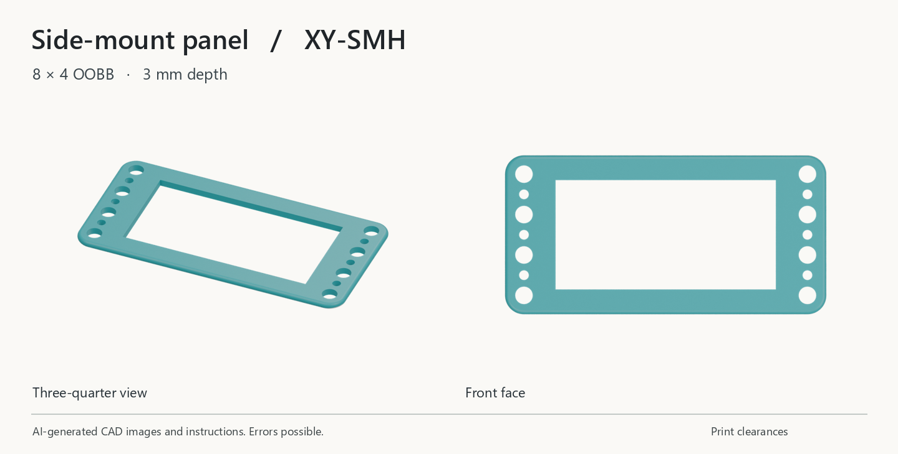
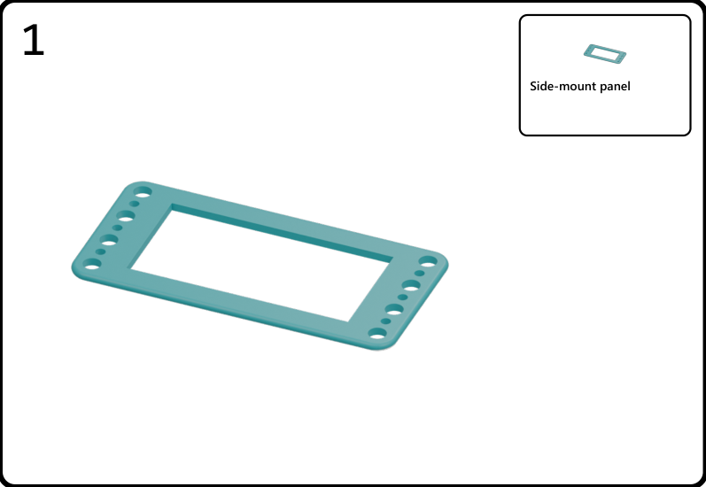
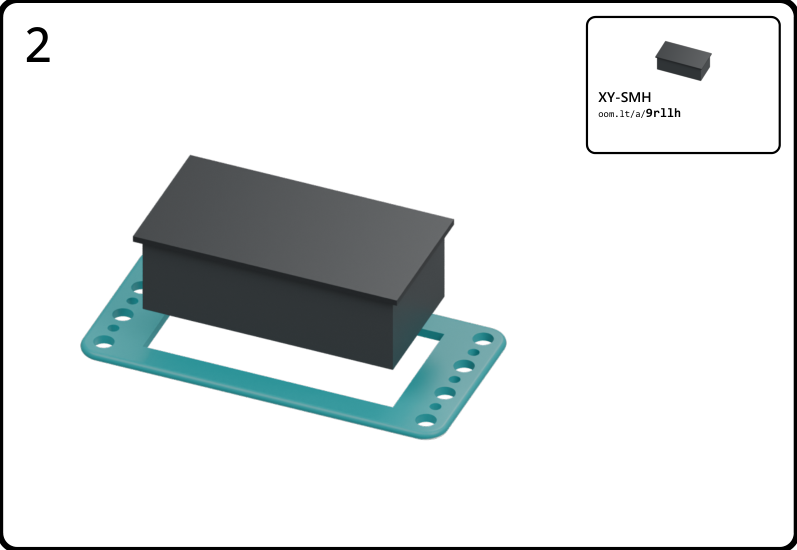
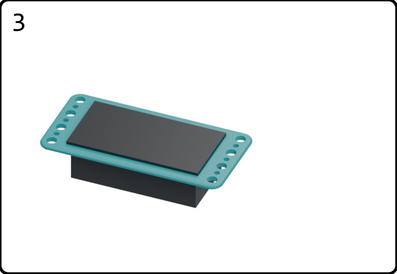

<!-- oobb-presentation:start -->
# XY-SMH · Side-mount panel

AI-generated CAD images and instructions. Errors possible.

## Summary

A panel with one mounting row on each side of the device.

This is an entirely AI-generated coding project. The source code is largely unreadable by humans. The generated files are included so others can use and modify the designs with their own AI tools.

[](./)

## Details

**Full OOMP ID** `oobb_part_holder_electronic_panel_mount_motor_controller_stepper_single_axis_aliexpress_xy_smh_panel_width_only_8_width_4_height_3_depth`

[Part folder](./) · [OOBB navigation](../../navigation_oobb/oobb/part/holder/electronic_panel_mount_motor_controller_stepper_single_axis_aliexpress_xy_smh/panel_width_only/8_width/4_height/3_depth/) · [Source device](https://github.com/oomlout/oomp_electronic_panel_mount_version_5/tree/main/parts/electronic_panel_mount_motor_controller_stepper_single_axis_86_mm_width_45_mm_height_28_mm_depth_aliexpress_xy_smh)

| Dimension | Value |
| --- | --- |
| OOBB width × height | 8 × 4 grid units |
| Depth | 3 mm |
| Front opening | 81.6 × 40.6 mm |
| Clip shoulder | 3 mm |

<details>
<summary>Complete OOMP metadata</summary>

```yaml
assembly_steps:
- action: Print one holder using the 3D-print STL. Clear the opening and identify
    the front face.
  view: part_holder
- action: With the device disconnected, align its body with the opening. Keep the
    bezel outside the holder.
  view: aligned
- action: Press the body straight into the opening until the bezel sits flat. Check
    that the clips engage before mounting the holder.
  view: seated
bip_39_2_word_array:
- shed
- arrest
bip_39_2_word_no_space: shedarrest
bip_39_2_word_space: shed arrest
bip_39_2_word_underscore: shed_arrest
bip_39_3_word_array:
- shed
- arrest
- analyst
bip_39_3_word_no_space: shedarrestanalyst
bip_39_3_word_space: shed arrest analyst
bip_39_3_word_underscore: shed_arrest_analyst
bip_39_full_array:
- shed
- arrest
- analyst
- category
- kite
- online
- myth
- brand
- very
- rice
- orphan
- child
bip_39_full_no_space: shedarrestanalystcategorykiteonlinemythbrandveryriceorphanchild
bip_39_full_space: shed arrest analyst category kite online myth brand very rice orphan
  child
bip_39_full_underscore: shed_arrest_analyst_category_kite_online_myth_brand_very_rice_orphan_child
device_label: xy_smh
directory: parts/oobb_part_holder_electronic_panel_mount_motor_controller_stepper_single_axis_aliexpress_xy_smh_panel_width_only_8_width_4_height_3_depth
id: oobb_part_holder_electronic_panel_mount_motor_controller_stepper_single_axis_aliexpress_xy_smh_panel_width_only_8_width_4_height_3_depth
id_no_class: oobb_part_holder_electronic_panel_mount_motor_controller_stepper_single_axis_aliexpress_xy_smh_panel_width_only_8_width_4_height_3_depth
id_no_size: oobb_part_holder_electronic_panel_mount_motor_controller_stepper_single_axis_aliexpress_xy_smh_panel_width_only_8_width_4_height_3_depth
id_no_type: oobb_part_holder_electronic_panel_mount_motor_controller_stepper_single_axis_aliexpress_xy_smh_panel_width_only_8_width_4_height_3_depth
md5: c5418c211217b335e4a0d8f2f7267313
md5_10: c5418c2112
md5_10_upper: C5418C2112
md5_5: c5418
md5_5_upper: C5418
md5_6: c5418c
md5_6_alpha: 7p2to
md5_6_alpha_upper: 7P2TO
md5_6_upper: C5418C
name: Oobb Part Holder Electronic Panel Mount Motor Controller Stepper Single Axis
  Aliexpress Xy Smh Panel Width Only 8 Width 4 Height 3 Depth
name_no_class: Oobb Part Holder Electronic Panel Mount Motor Controller Stepper Single
  Axis Aliexpress Xy Smh Panel Width Only 8 Width 4 Height 3 Depth
name_no_size: Oobb Part Holder Electronic Panel Mount Motor Controller Stepper Single
  Axis Aliexpress Xy Smh Panel Width Only 8 Width 4 Height 3 Depth
name_no_type: Oobb Part Holder Electronic Panel Mount Motor Controller Stepper Single
  Axis Aliexpress Xy Smh Panel Width Only 8 Width 4 Height 3 Depth
oobb_details:
  cavity_depth_mm: 29
  cavity_height_mm: 46.0
  cavity_width_mm: 87.0
  corner_radius_mm: 7
  depth: 3
  depth_cutout_mm: 3
  depth_mm: 28
  edge_radius_mm: 1.5
  height: 4
  height_cutout_mm: 40.6
  height_mm: 45
  oobb_type: panel_width_only
  run_scad: true
  variant: panel_width_only
  width: 8
  width_cutout_mm: 81.6
  width_mm: 86
oomp_key: oomp_oobb_part_holder_electronic_panel_mount_motor_controller_stepper_single_axis_aliexpress_xy_smh_panel_width_only_8_width_4_height_3_depth
source_device_url: https://github.com/oomlout/oomp_electronic_panel_mount_version_5/tree/main/parts/electronic_panel_mount_motor_controller_stepper_single_axis_86_mm_width_45_mm_height_28_mm_depth_aliexpress_xy_smh
source_oomp_id: electronic_panel_mount_motor_controller_stepper_single_axis_86_mm_width_45_mm_height_28_mm_depth_aliexpress_xy_smh
taxonomy_1: oobb
taxonomy_10: ''
taxonomy_11: ''
taxonomy_12: ''
taxonomy_13: ''
taxonomy_14: ''
taxonomy_15: ''
taxonomy_1_capital: Oobb
taxonomy_1_first_letter: o
taxonomy_1_first_letter_upper: O
taxonomy_1_length_1: o
taxonomy_1_length_2: oo
taxonomy_1_length_3: oob
taxonomy_1_length_4: oobb
taxonomy_1_length_5: oobb
taxonomy_1_upper: OOBB
taxonomy_1_upper_length_1: O
taxonomy_1_upper_length_2: OO
taxonomy_1_upper_length_3: OOB
taxonomy_1_upper_length_4: OOBB
taxonomy_1_upper_length_5: OOBB
taxonomy_2: part
taxonomy_2_capital: Part
taxonomy_2_first_letter: p
taxonomy_2_first_letter_upper: P
taxonomy_2_length_1: p
taxonomy_2_length_2: pa
taxonomy_2_length_3: par
taxonomy_2_length_4: part
taxonomy_2_length_5: part
taxonomy_2_upper: PART
taxonomy_2_upper_length_1: P
taxonomy_2_upper_length_2: PA
taxonomy_2_upper_length_3: PAR
taxonomy_2_upper_length_4: PART
taxonomy_2_upper_length_5: PART
taxonomy_3: holder
taxonomy_3_capital: Holder
taxonomy_3_first_letter: h
taxonomy_3_first_letter_upper: H
taxonomy_3_length_1: h
taxonomy_3_length_2: ho
taxonomy_3_length_3: hol
taxonomy_3_length_4: hold
taxonomy_3_length_5: holde
taxonomy_3_upper: HOLDER
taxonomy_3_upper_length_1: H
taxonomy_3_upper_length_2: HO
taxonomy_3_upper_length_3: HOL
taxonomy_3_upper_length_4: HOLD
taxonomy_3_upper_length_5: HOLDE
taxonomy_4: electronic_panel_mount_motor_controller_stepper_single_axis_aliexpress_xy_smh
taxonomy_4_capital: Electronic Panel Mount Motor Controller Stepper Single Axis Aliexpress
  Xy Smh
taxonomy_4_first_letter: e
taxonomy_4_first_letter_upper: E
taxonomy_4_length_1: e
taxonomy_4_length_2: el
taxonomy_4_length_3: ele
taxonomy_4_length_4: elec
taxonomy_4_length_5: elect
taxonomy_4_upper: ELECTRONIC_PANEL_MOUNT_MOTOR_CONTROLLER_STEPPER_SINGLE_AXIS_ALIEXPRESS_XY_SMH
taxonomy_4_upper_length_1: E
taxonomy_4_upper_length_2: EL
taxonomy_4_upper_length_3: ELE
taxonomy_4_upper_length_4: ELEC
taxonomy_4_upper_length_5: ELECT
taxonomy_5: panel_width_only
taxonomy_5_capital: Panel Width Only
taxonomy_5_first_letter: p
taxonomy_5_first_letter_upper: P
taxonomy_5_length_1: p
taxonomy_5_length_2: pa
taxonomy_5_length_3: pan
taxonomy_5_length_4: pane
taxonomy_5_length_5: panel
taxonomy_5_upper: PANEL_WIDTH_ONLY
taxonomy_5_upper_length_1: P
taxonomy_5_upper_length_2: PA
taxonomy_5_upper_length_3: PAN
taxonomy_5_upper_length_4: PANE
taxonomy_5_upper_length_5: PANEL
taxonomy_6: 8_width
taxonomy_6_capital: 8 Width
taxonomy_6_first_letter: '8'
taxonomy_6_first_letter_upper: '8'
taxonomy_6_length_1: '8'
taxonomy_6_length_2: '8_'
taxonomy_6_length_3: 8_w
taxonomy_6_length_4: 8_wi
taxonomy_6_length_5: 8_wid
taxonomy_6_upper: 8_WIDTH
taxonomy_6_upper_length_1: '8'
taxonomy_6_upper_length_2: '8_'
taxonomy_6_upper_length_3: 8_W
taxonomy_6_upper_length_4: 8_WI
taxonomy_6_upper_length_5: 8_WID
taxonomy_7: 4_height
taxonomy_7_capital: 4 Height
taxonomy_7_first_letter: '4'
taxonomy_7_first_letter_upper: '4'
taxonomy_7_length_1: '4'
taxonomy_7_length_2: '4_'
taxonomy_7_length_3: 4_h
taxonomy_7_length_4: 4_he
taxonomy_7_length_5: 4_hei
taxonomy_7_upper: 4_HEIGHT
taxonomy_7_upper_length_1: '4'
taxonomy_7_upper_length_2: '4_'
taxonomy_7_upper_length_3: 4_H
taxonomy_7_upper_length_4: 4_HE
taxonomy_7_upper_length_5: 4_HEI
taxonomy_8: 3_depth
taxonomy_8_capital: 3 Depth
taxonomy_8_first_letter: '3'
taxonomy_8_first_letter_upper: '3'
taxonomy_8_length_1: '3'
taxonomy_8_length_2: '3_'
taxonomy_8_length_3: 3_d
taxonomy_8_length_4: 3_de
taxonomy_8_length_5: 3_dep
taxonomy_8_upper: 3_DEPTH
taxonomy_8_upper_length_1: '3'
taxonomy_8_upper_length_2: '3_'
taxonomy_8_upper_length_3: 3_D
taxonomy_8_upper_length_4: 3_DE
taxonomy_8_upper_length_5: 3_DEP
taxonomy_9: ''
```

</details>

## Parts

One printed holder and one [XY-SMH panel-mount device](https://github.com/oomlout/oomp_electronic_panel_mount_version_5/tree/main/parts/electronic_panel_mount_motor_controller_stepper_single_axis_86_mm_width_45_mm_height_28_mm_depth_aliexpress_xy_smh). Choose chassis screws to suit the receiving structure.

## Assembly

1. Print one holder using the 3D-print STL. Clear the opening and identify the front face.

   <a href="assembly/cards/step_01.png"></a>

2. With the device disconnected, align its body with the opening. Keep the bezel outside the holder.

   <a href="assembly/cards/step_02.png"></a>

3. Press the body straight into the opening until the bezel sits flat. Check that the clips engage before mounting the holder.

   <a href="assembly/cards/step_03.png"></a>

The gray shape represents the catalog device envelope. Clip travel and physical fit still need a sample print.

[Offline HTML viewer](assembly/assembly_instructions.html) · [Printable PDF](assembly/assembly_instructions.pdf)
<!-- oobb-presentation:end -->
